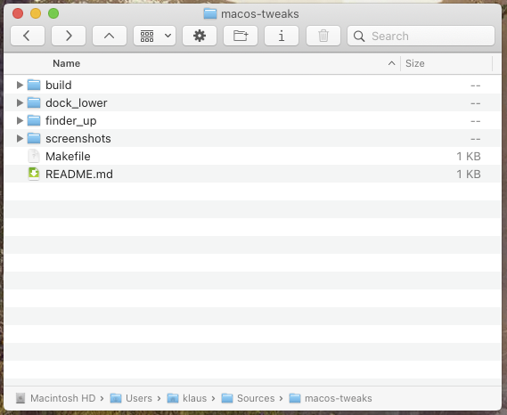
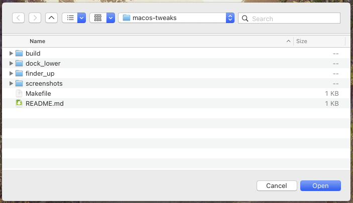

# macos-tweaks

Small Ammonia tweaks that bring back behaviours macOS is missing.
best used with [BackToCatalina](https://github.com/nfzerox/BackToCatalina) for the good old macos look. this runs on macos 27

## finderup

Separate buttons for : Back, Forward and Up (Enclosing Folder), in two places:

- **Finder toolbar** (`libfinderup.dylib`): three buttons offered in View > Customize Toolbar.
- **Open/Save panels** (`libpanelnav.dylib`): replacing the Back/Forward combo button.





## docklower

A real "lower window", like on Linux: middle-click a window's title bar to send it to the
back of the window stack, without activating any other window.

- `libdocklower.dylib` runs inside the Dock, the only process allowed to reorder other apps' windows.
- `docklower.lua` (Hammerspoon) catches the middle-click and asks the Dock to lower the window.
  Brave browser tab strip is left alone, so middle-click still closes tabs.

## itermtweaks

`libitermtweaks.dylib`, loaded in iTerm2 only:

- **Short context menu**: right-click in the terminal keeps only Copy, Paste, Select All and
  Clear Buffer (plus Copy Link Address / Copy URL on links). Image, mark and timestamp menus are
  left alone.
- **Sequoia-style tabs fill the tab bar**: with "Use Sequoia-style tabs" on macOS 26+, iTerm2
  3.7.5 keeps the padding meant for its Tahoe tabs, leaving an empty strip under the tabs.

## Requirements

- Apple Silicon Mac, SIP disabled, [Ammonia](https://github.com/CoreBedtime/ammonia) installed
- Xcode Command Line Tools (`xcode-select --install`)
- [Hammerspoon](https://www.hammerspoon.org) for docklower

## Install

```
make install
```

For docklower, also copy `dock_lower/docklower.lua` to `~/.hammerspoon/` and add
`require("docklower")` to your `~/.hammerspoon/init.lua`.

Uninstall with `make uninstall`.
