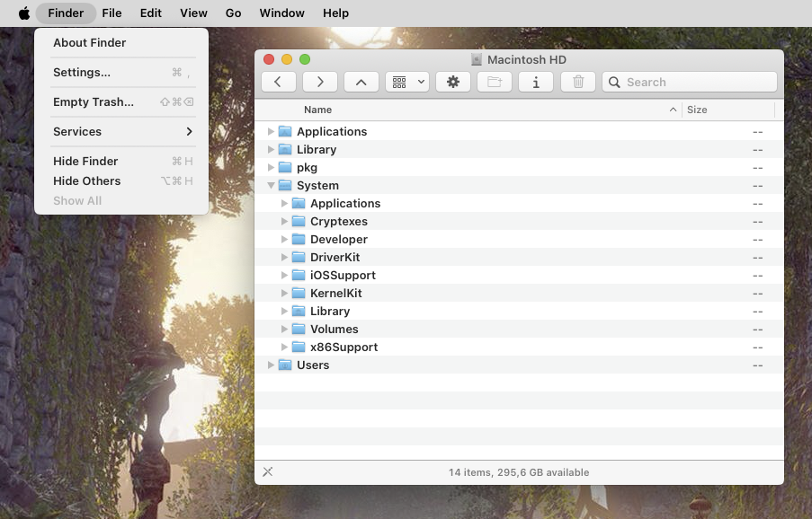

# boldtext

`libboldtext.dylib`: bold text everywhere, like iOS's Bold Text option. The system font turns
semibold in every app (AppKit and SwiftUI), the menu bar, the Dock, Spotlight, System Settings
and Open/Save panels. Text that was already bold stays bold, and fonts an app picks by name
(documents, the terminal's font, symbol fonts) are left alone.

- The Finder sidebar stays regular: BackToCatalina keeps it so.
- Install: `make install-boldtext`, then relaunch the apps.
- Turn it off with `defaults write -g TweaksBoldText -bool NO` (`YES` to turn it back on),
  then relaunch the apps.
