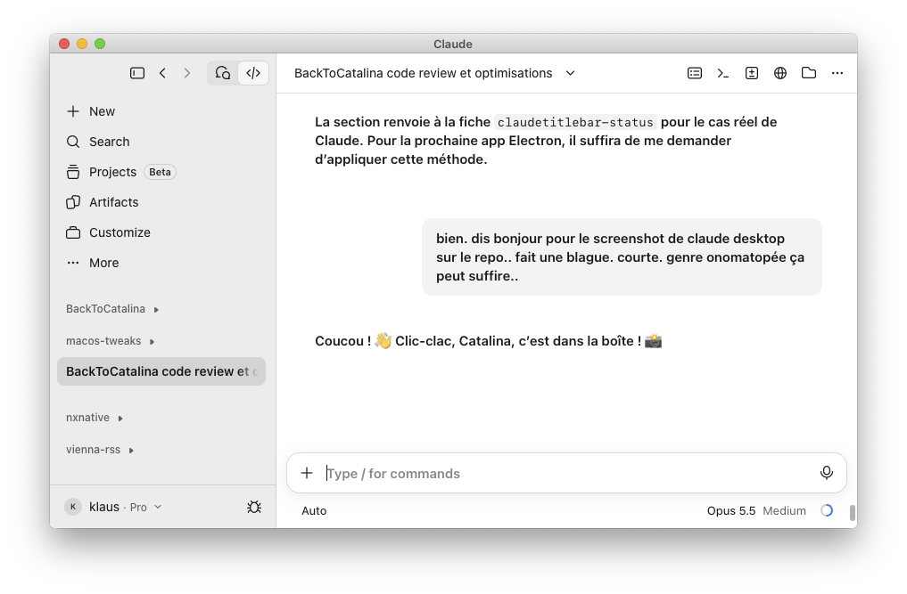

# claudetitlebar

`libclaudetitlebar.dylib`, loaded in Claude desktop only: its windows get a real title bar, grey
like BackToCatalina's, with the title and the window buttons in it, and the app's content starts
below it instead of running under a transparent title bar.

- The app's own top bar (drawn in HTML) stays as it is, below the new title bar.
- Install: `make install-claudetitlebar`, then quit and reopen Claude.
- Turn it off with `defaults write -g TweaksClaudeTitlebar -bool NO` (`YES` to turn it back on),
  then quit and reopen Claude.

