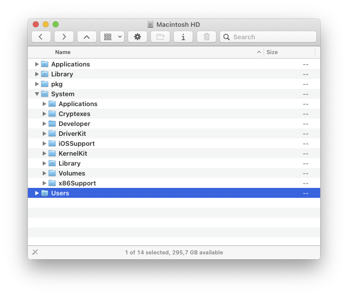
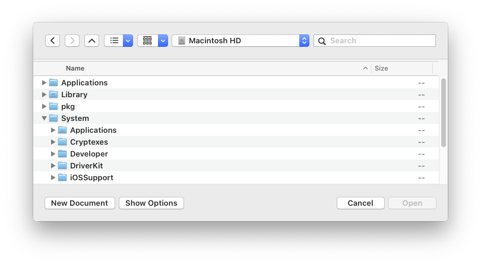

# finderup

Separate buttons for Back, Forward and Up (Enclosing Folder), in two places:

- **Finder toolbar** (`libfinderup.dylib`): three buttons offered in View > Customize Toolbar.
- **Open/Save panels** (`libpanelnav.dylib`): replacing the Back/Forward combo button.

Install: `make install-finderup`.
