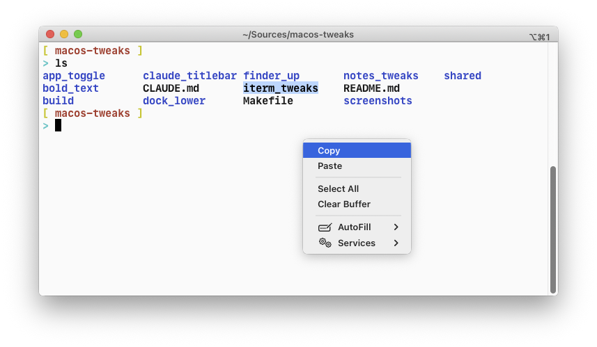

# itermtweaks

`libitermtweaks.dylib`, loaded in iTerm2 only:

- **Short context menu**: right-click in the terminal keeps only Copy, Paste, Select All and
  Clear Buffer (plus Copy Link Address / Copy URL on links). Image, mark and timestamp menus are
  left alone.
- **Sequoia-style tabs fill the tab bar**: with "Use Sequoia-style tabs" on macOS 26+, iTerm2
  3.7.5 keeps the padding meant for its Tahoe tabs, leaving an empty strip under the tabs.

Install: `make install-itermtweaks`, then relaunch iTerm2.
