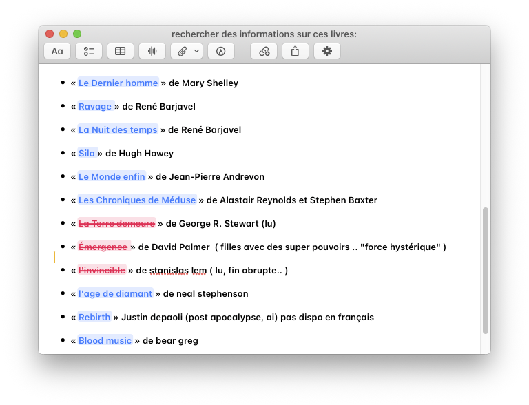

# notestweaks

`libnotestweaks.dylib`, loaded in Notes only:

- **Black body text**: the note editor draws plain text in the system text color, opaque black
  in Light mode and opaque white in Dark mode, like TextEdit, instead of Notes' own grey.
  Text you colored yourself, links, the note list and its greyed previews are left alone.
  Nothing is saved into your notes: the color is only applied on screen.
- **Bordered Markup button**: the toolbar's Markup button is drawn as a button like the others,
  in the main window and in note windows, instead of a bare symbol (Notes leaves it unbordered,
  which shows with BackToCatalina).
- **Always Bold**: a toolbar button, offered in View > Customize Toolbar. While it is on,
  everything you type is bold, in every note, even after Return, until you turn it off. The bold
  is real formatting, saved in the note (so it shows on iPhone and iPad too). The setting is kept
  when Notes restarts, even if you remove the button from the toolbar. Bolding or unbolding a
  selection still works as usual.

Install: `make install-notestweaks`, then relaunch Notes.
